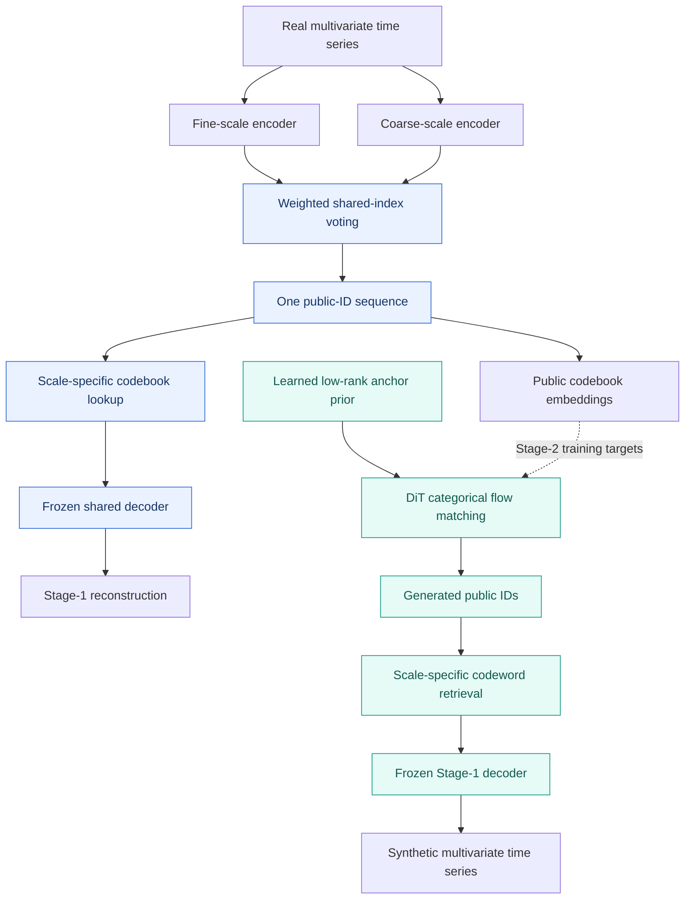

<div align="center">

# UniFlow

### Unified Multiscale Time-Series Generation via Categorical Flow Matching

**One shared semantic token sequence. Multiple temporal scales. Non-autoregressive generation.**

<p>
  
  
  
  
</p>

[Overview](#overview) · [Architecture](#architecture) · [Installation](#installation) · [Quick Start](#quick-start) · [Datasets](#datasets) · [Repository Structure](#repository-structure) · [Notes](#reproducibility-notes)

</div>

---

## Overview

**UniFlow** is a two-stage framework for unconditional multivariate time-series generation. It combines **shared-semantic multiscale tokenization** with **geometry-aware categorical flow matching**. The central design is to capture complementary temporal resolutions **without exposing a separate token stream for every scale** to the generator.

- **Stage 1 — Shared-semantic multiscale tokenizer:** aligned temporal branches vote for **one public code ID per position**. Branch-specific codebooks retain scale-specific detail for decoding.
- **Stage 2 — Categorical flow generator:** a learned low-rank anchor prior initializes a DiT-based flow model. Position-wise categorical predictions yield codebook-expected endpoints, enabling joint, non-autoregressive transport.
- **Unified decoding:** generated public IDs retrieve the corresponding scale-specific codewords and are decoded back into a time series.

UniFlow builds on the categorical flow/low-rank-anchor direction of [SDFlow: Similarity-Driven Flow Matching for Time Series Generation](https://arxiv.org/abs/2605.05736), extending it with a shared multiscale semantic interface.

## Architecture



> **Core idea:** preserve multiscale information in the *representation*, while keeping the *generator-facing sequence length* fixed.

## Installation

Replace `YOUR_USERNAME` with the GitHub account hosting this repository, then create the supplied Conda environment:

```bash
git clone https://github.com/YOUR_USERNAME/UniFlow.git
cd UniFlow
conda env create -f environment.yaml
conda activate uniflow
```

**Compatibility:** `environment.yaml` records a legacy research environment (Python 3.8, PyTorch 1.12.1 + CUDA 11.3). GPU and PyTorch installation may require adaptation to the CUDA drivers and package indexes available on your machine. The environment has **not** been revalidated on a clean host as part of this repository cleanup.

## Quick Start

The commands below reproduce the **Energy, sequence length 24** configuration provided with the repository. Run commands from the repository root and prepare the data file first (see [Datasets](#datasets)). CUDA is expected for the provided training setup.

### 1 · Train the shared-semantic tokenizer (Stage 1)

```bash
python stage1_vq/train_vq.py \
  --dataname energy --window-size 24 \
  --out-dir ./output/output_energy_multipatch_weighted \
  --exp-name VQVAE_MS_P24_D192_320_W4060 \
  --batch-size 128 --num-workers 8 --gpu 0 \
  --total-iter 100000 --lr 1e-4 --lr-scheduler 200000 \
  --width 512 --code-dim 512 --nb-code 512 \
  --down-t 2 --depth 3 --dilation-growth-rate 3 \
  --vq-act relu --quantizer ema_reset_sim --commit 0.001 \
  --multi-scale-vq --multi-scale-mode patch \
  --multi-scale-dims 192 320 \
  --multi-scale-depths 2 4 \
  --multi-scale-dilations 1 3 \
  --multi-scale-patches 2 4 \
  --multi-scale-patch-downs 1 0 \
  --multi-scale-weights 0.4 0.6
```

Stage-1 model selection writes a tokenizer checkpoint at:

```text
output/output_energy_multipatch_weighted/
└── VQVAE_MS_P24_D192_320_W4060/
    └── net_best_ds.pth
```

### 2 · Train categorical flow matching (Stage 2)

```bash
python stage2_flow/train_uniflow.py \
  --vqvae_ckpt ./output/output_energy_multipatch_weighted/VQVAE_MS_P24_D192_320_W4060/net_best_ds.pth \
  --dataname energy --output_dir ./checkpoints_energy \
  --window_size 24 --down_t 2 --quantizer ema_reset_sim \
  --rank 256 --d_model 512 --n_layers 1 --num_heads 16 \
  --dropout 0.1 --noise_std 0.01 \
  --lambda_mean 0.1 --lambda_std 10.0 \
  --batch_size 64 --lr 1e-4 --lr_uv 1e-3 \
  --max_iters 100000 --print_interval 200 \
  --eval_interval 5000 --eval_steps 20 --device cuda
```

The Stage-2 trainer evaluates generated samples periodically and saves its best checkpoint by Discriminative Score:

```text
checkpoints_energy/best_ds.pth
```

> Stage 2 expects a compatible, **trained Stage-1 checkpoint** and its associated configuration. The checkpoint is not included in this repository.

### 3 · Explore supplied experiment scripts

Configuration scripts are grouped under `scripts/stage1_VQ/` and `scripts/stage2_Flow/`. The Stage-1 shell scripts include Sine, Stock, ETTh, and Energy variants; Stage-2 examples are supplied as Windows `.bat` scripts. You can also adapt the commands above for your dataset and sequence length.

## Datasets

The data files are **not bundled**. The current loader (`dataset/dataset_VQ.py`) uses these repository-relative paths:

| Dataset key | File expected by loader | Format |
|:--|:--|:--|
| `sine` | `dataset/sine_ground_truth_24_train.npy` | NumPy array |
| `stock` | `dataset/stock_data.csv` | CSV |
| `etth` | `dataset/ETTh.csv` | CSV; first column is ignored by the loader |
| `energy` | `dataset/energy_data.csv` | CSV |

Prepare the data in the expected format and location before running the commands. The loader also contains entries for `fmri` and `mujoco`, but these are not part of the main four-dataset UniFlow setup shown above. Respect the original datasets' access and redistribution terms.

## Repository Structure

```text
UniFlow/
├── README.md                         # Project overview and reproduction guide
├── environment.yaml                  # Recorded training environment
├── dataset/dataset_VQ.py             # Dataset loading and preprocessing
├── models/
│   ├── uniflow.py                    # UniFlow categorical flow & anchor prior
│   ├── vqvae.py                      # Shared-index multiscale tokenizer
│   ├── quantize_cnn.py               # Quantization and codebook operations
│   ├── encdec.py                     # Convolutional encoder/decoder components
│   └── resnet.py                     # Residual convolutional blocks
├── stage1_vq/
│   ├── train_vq.py                   # Stage-1 training
│   ├── eval_single_scale_latent.py   # Single-view reconstruction diagnostics
│   └── eval_generated_multiscale_consistency.py
├── stage2_flow/
│   ├── train_uniflow.py              # Stage-2 training and periodic evaluation
│   └── eval_single_scale_generation.py
├── metrics/                          # DS, PS, C-FID, and evaluation utilities
├── scripts/                          # Experiment-specific configurations
└── NAMING_AUDIT.md                   # Naming migration and compatibility notes
```

## Evaluation

- **DS (Discriminative Score)**: assesses distinguishability of real and generated sequences.
- **PS (Predictive Score)**: evaluates downstream temporal predictive utility.
- **C-FID (Context-Fréchet Distance)**: compares learned temporal-feature distributions.
- **Single-view diagnostics**: provided scripts examine code assignment agreement and single-scale generation variants.

The Stage-2 trainer computes DS, PS, and C-FID during periodic evaluations. The specific implementations are in `metrics/`; evaluation protocol, data split, preprocessing, and sample count should be held fixed for comparisons.

## Reproducibility Notes

- **Legacy names preserved for compatibility.** The public Stage-2 entry point is `train_uniflow.py`, but historical `train_sdflow.py`, `models.sdflow`, `utils.eval_sdflow`, and `--sdflow_ckpt` continue to work as aliases. Existing checkpoint tensor keys are not renamed.
- **Data splits.** The current CSV loader allocates **100% of rows to training** and creates empty validation/test partitions (`dataset/dataset_VQ.py`). This follows the supplied code, but is **not** a ready-made held-out evaluation split; adjust it for external evaluations where necessary.
- **Preprocessing.** CSV datasets are min–max normalized using statistics calculated on the loaded data; take care to prevent leakage if introducing new train/test splits.
- **Checkpoints and datasets.** No pretrained checkpoints or dataset files are distributed in this archive.
- **Runtime validation.** The repository has passed Python source compilation checks after the naming migration, but full training and metric reproduction require the appropriate environment and datasets.

## Citation

A UniFlow BibTeX entry can be added when its manuscript metadata is finalized. UniFlow builds on [SDFlow](https://arxiv.org/abs/2605.05736), which should be acknowledged where relevant.

## License

No license file was included in the supplied project archive. Please add the license you intend to use before announcing reuse permissions for this GitHub repository.

---

<div align="center"><sub>UniFlow · Shared semantics across temporal scales, one unified generative interface.</sub></div>
